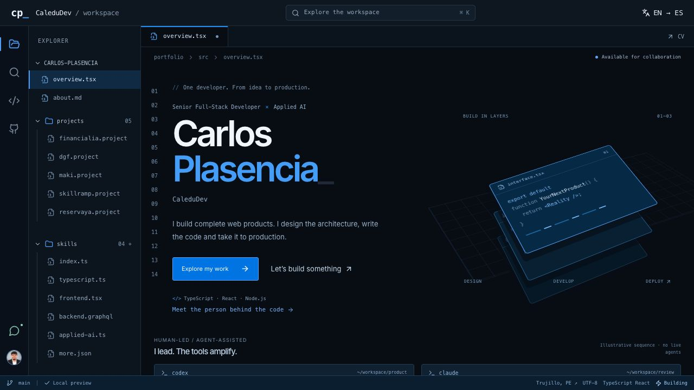

# CaleduDev · Carlos Plasencia

**Web products, from idea to production.**

My bilingual portfolio for full-stack development, applied AI and SaaS products. A blue, editor-inspired workspace where you can explore my projects, technical skills and services.

[Visit the portfolio](https://www.carlosplasencia.dev/) · [English version](https://www.carlosplasencia.dev/en/) · [About me](https://www.carlosplasencia.dev/en/about/) · [Let's work together](https://www.carlosplasencia.dev/en/contact/)

[](https://www.carlosplasencia.dev/en/)

*Actual desktop capture of the published portfolio, not a product mockup.*

## Inside the workspace

- **Explore like code:** project files, technology sections, command search (`Cmd/Ctrl+K`) and previous/next navigation.
- **Try project concepts:** separate interactive simulations for finance, content management, restaurant ordering, learning and scheduling.
- **Switch between Spanish and English:** dedicated URLs, server-rendered content and page-specific metadata.
- **Get in touch:** contact options in one place and language-specific CVs that open in a new tab.

The project demos and Codex/Claude terminal sequences are illustrative. They do not connect to production systems or run live agents.

## Built with

| Layer | Technologies |
| --- | --- |
| Static site | Astro 7 |
| Interactive interface | React 18 · TypeScript |
| Styling and motion | Tailwind CSS 3 · Framer Motion · Lucide icons |
| Content and discovery | Bilingual HTML · JSON-LD · Sitemap · `llms.txt` |
| Tooling | pnpm · Node.js |

## Selected work

| Project | My contribution | Case study |
| --- | --- | --- |
| **Financialia** | Own Totora Studio product, developed independently; voice/text input, Claude integration, server-side validation and user confirmation. | [Explore Financialia](https://www.carlosplasencia.dev/en/projects/financialia/) |
| **DGF Inmobiliaria** | Independent client design, development and deployment, including configurable content and management modules. | [Explore DGF](https://www.carlosplasencia.dev/en/projects/dgf-inmobiliaria/) |
| **Maki Panda** | Independent client delivery with a configurable menu, loyalty program and location-specific ordering links. | [Explore Maki Panda](https://www.carlosplasencia.dev/en/projects/maki-panda/) |
| **Skillramp** | Architecture and development leadership for Aptura Labs with a multidisciplinary team; not a solo implementation. | [Explore Skillramp](https://www.carlosplasencia.dev/en/projects/skillramp/) |
| **ReservaYa** | Own scheduling and payments product. | [Explore ReservaYa](https://www.carlosplasencia.dev/en/projects/reservaya/) |

This repository contains the **portfolio**, not the source code of these products or client projects.

## Run locally

Use Node.js 22.23.4 or newer and pnpm 9.15.4.

```sh
pnpm install --frozen-lockfile
pnpm dev
```

Open the local address printed by Astro. No environment variables, account credentials or backend services are required.

## Check and build

```sh
pnpm test
pnpm typecheck
pnpm build
node tests/verify-seo-build.mjs
pnpm preview
```

The build produces `dist/`. Building and previewing do not deploy the site.

Tests check bilingual content, project attribution, language resolution, metadata and the integrity of approved public assets. Browser checks are still needed for responsive layouts, keyboard interaction and language persistence.

<details>
<summary><strong>Maintainer notes: content, interactions and SEO</strong></summary>

## Edit the portfolio

| Area | Location |
| --- | --- |
| Spanish and English copy, contact links, project evidence | `src/lib/i18n.ts` |
| Language persistence and document metadata | `src/contexts/LanguageContext.tsx` |
| Home route and workspace interactions | `src/pages/index.astro`, `src/components/workspace/WorkspacePreview.tsx` |
| Workspace visual system and local fonts | `src/styles/workspace.css`, `src/styles/globals.css` |
| Server-rendered metadata and structured data | `src/layouts/Layout.astro` |
| Approved portrait, CVs and Financialia cases | `public/` |

The URL controls the server-rendered language: Spanish at `/` and English under `/en/`. Each section and project has its own localized HTML, canonical URL and reciprocal `hreflang` links. Hydration does not replace page-specific metadata or override the URL with a browser preference. Only the standalone `/workspace` prototype keeps the saved/browser preference behavior.

Project artwork is a typographic presentation, not a screenshot of the products. The included portrait and PDFs are personal portfolio materials; no open-source license has been selected for them or this source.

## Workspace home page

Open `/` on the local server to use the workspace design as the main page. The home route retains the canonical URL, social metadata and structured data. `/workspace` remains a separate noindex preview of the same interface. The public site is available at [carlosplasencia.dev](https://www.carlosplasencia.dev/). Browse the biography, projects, core skill files, additional tools and services using the explorer, search (`Cmd/Ctrl+K`) or previous/next links below each page. The explorer, language switch and previous/next navigation expose real links. Existing workspace fragments such as `/#financialia` redirect in the browser to the corresponding localized page; `/workspace#financialia` retains the prototype behavior.

Each project has its own concept illustration and a local interactive simulation: Financialia's review-gated transaction pipeline, DGF's content preview, Maki Panda's sample order/loyalty flow, Skillramp's creator/student view and ReservaYa's sample availability. Illustrations are not product screenshots; sample content and rules are not production data. Simulations make no network calls and persist nothing. Navigating away resets them.

The overview's Codex and Claude terminal sequences are illustrative, not live agent sessions. The language control links directly to the same page in ES/EN. Motion follows the system's reduced-motion preference; Financialia uses manual steps when reduced motion is enabled. The contact page lets visitors choose WhatsApp, LinkedIn, email, GitHub or Totora Studio. Email can be copied without launching a mail application. CV links open the language-specific PDF in a new tab rather than forcing a download. The `/workspace` preview remains `noindex,nofollow`; the home route retains its normal indexing metadata. Local development and build commands do not publish changes.

## Toolchain maintenance

Astro 7 and its React integration run the static build. React remains on version 18 and Tailwind on version 3 to preserve the current rendering and visual system. Tailwind and Autoprefixer are configured directly through Vite PostCSS; the legacy Astro Tailwind integration is not compatible with this Astro release. Existing Tailwind directives provide the base styles once. Default client chunking replaces the removed Rollup manual-chunk configuration.

Use `pnpm audit` after dependency updates, then run the checks above and inspect desktop/mobile interactions in a browser. An audit result describes known registry advisories, not a guarantee that every vulnerability has been discovered.

Two consumer-specific pnpm overrides pin `postcss-selector-parser` to 7.1.6 for Tailwind 3.4.19 and postcss-nested 6.2.0 (GHSA-rj75-hqrm-r3gf). This intentionally exceeds their declared 6.x ranges; it is a tested compatibility workaround, not an upstream-supported range. The selector regression test pins pre-override CSS semantics for responsive/dark/interaction/arbitrary variants and `@apply`. Revalidate these pins when upgrading either consumer; do not broaden them globally.

## Search and AI-readable context

`src/lib/seo.ts` is the shared route and metadata catalogue. The static catch-all route renders every section and project in both languages. `sitemap.xml`, `llms.txt` and `llms-full.txt` are generated from the same public content during the build, avoiding manually duplicated routes and claims. The sitemap excludes the noindex `/workspace` prototype. No synthetic modification dates are published.

The layout emits Person, WebSite and page/breadcrumb JSON-LD. Project CreativeWork entries describe the actual contribution, without presenting team work as sole authorship. Services include Service entries and FAQPage data derived from the same visible questions and answers. FAQ markup does not imply eligibility for Google FAQ rich results.

`llms.txt` is an optional proposed context format, not an indexing directive, a replacement for `robots.txt`, or a guarantee of rankings or AI citations. No new training-bot policy is introduced. Important content remains available as ordinary HTML with crawlable links. After an authorized production release, check response headers, redirects and indexing on the custom domain, then submit the generated sitemap through Search Console. Local validation cannot establish production indexing.

References: [Google AI features](https://developers.google.com/search/docs/appearance/ai-features), [JavaScript SEO and real URLs](https://developers.google.com/search/docs/crawling-indexing/javascript/javascript-seo-basics), [llms.txt proposal](https://llmstxt.org/).

</details>
